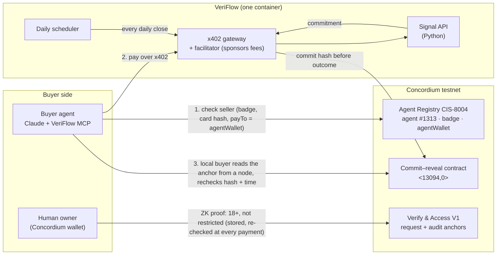
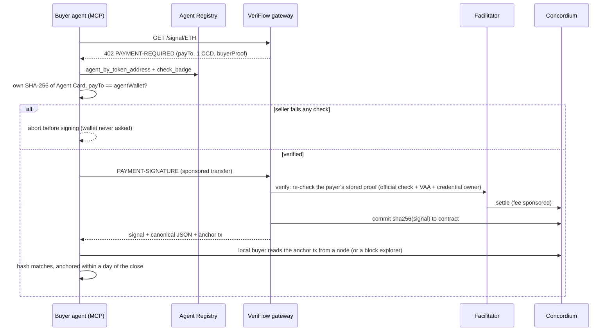

# VeriFlow

VeriFlow sells a BTC or ETH `RISK_ON` / `RISK_OFF` call over x402 on Concordium testnet. The seller is agent **#1313** in the Concordium Agent Registry. Every call is committed on contract **`<13115,0>`**, one per asset and day, by a committer (`4Hga…`) that the owner appointed and can revoke; the owner itself cannot commit. A buyer who holds the canonical string can SHA-256 it and find that digest under its own asset and day. `<13094,0>` is the retired v1 log.

[](https://github.com/jiahaoc040-ai/veriflow/actions/workflows/test.yml)
[](https://github.com/jiahaoc040-ai/veriflow/actions/workflows/docker.yml)
[](https://github.com/jiahaoc040-ai/veriflow/actions/workflows/contract.yml)
[](https://github.com/jiahaoc040-ai/veriflow/actions/workflows/security.yml)
[](https://github.com/jiahaoc040-ai/veriflow/actions/workflows/codeql.yml)


**Live demo: https://veriflow-yrhp.onrender.com** (testnet) — dashboard with in-browser verification · [`/verify`](https://veriflow-yrhp.onrender.com/verify) buyer eligibility · [Agent Card](https://veriflow-yrhp.onrender.com/.well-known/agent-card.json)

**Try it:** [TRY_IT.md](TRY_IT.md). Check a bought call in 2 minutes with no wallet, or buy one yourself.

**Docs:** [Scoring rule v2](docs/SCORING-v2.md) · [Scoring rule v1](docs/SCORING.md) · [Go-live plan](docs/GO_LIVE.md) · [Threat model](docs/THREAT_MODEL.md)

`sha256(docs/SCORING.md)` and `sha256(gateway/src/score.ts)` at `94c7603` are the register-data of [tx `39356396…`](https://ccdexplorer.io/testnet/transaction/39356396cd2f61573caae2228a68c770aa086b14195385b64b86e477cc3e8d95), sent by `4dNM…` at 2026-11-21 14:57:24 UTC, before any price outcome existed. For `<13094,0>` the published result is integrity only. Block day 2026-11-20 failed, with 3 BTC commits and 2 ETH commits. The `score` workflow reruns the rule daily on GitHub's machines from the chain and Binance, and it publishes no performance number for this contract.

| Check | What the code and chain do |
|---|---|
| Who is paid | The local buyer checks the badge, the card hash, and that `payTo` equals the on-chain `agentWallet`, before it signs (`gateway/src/counterparty.ts`). [`setAgentWallet`](https://ccdexplorer.io/testnet/transaction/8238b866de05398d95fd66be64a74b1f0e86279cd2b748838ebaa5fd4e44e33b) on `<12802,0>` names `3WSAJwTZ…`. A stock x402 client pays `payTo` without asking. |
| Who may buy | Before every payment settles, the gateway re-runs the official Verify & Access check on the buyer's stored proof: the zero-knowledge proof, the statements, the credential still active and the request still on-chain. It also checks that the audit record anchored on-chain is that proof's record, and that the credential still belongs to the paying account. Any failure, including a node error, refuses the payment. `GET /eligibility/:account` returns neither the proof nor the credential id. |
| The hash you hold | On `<13115,0>` a commit is keyed by `(asset, as_of)`. A second call for the same day is rejected, and so is a commit outside the day after that close. Only the appointed committer can commit, never the owner. After 7 days anyone can `reveal`. The contract hashes the text, requires its asset and day to equal the key, and requires `RISK_ON` exactly when `momentum_e6 > 0`. On the retired `<13094,0>` a different hash was simply a second commit, which is why its 2026-11-20 failed (3 BTC, 2 ETH). |
| How an agent calls it | Hosted `POST /mcp` and `POST /a2a` are read-only. Paying (`get_signal`) runs in the local stdio MCP server, with the buyer's own key. |

Transactions linked in this README are Concordium testnet transactions you can open on CCDExplorer. Built for the [Concordium Trusted Agents Hackathon](https://www.concordium.com/article/concordium-trusted-agents-hackathon-encode-club) (Encode Club, 2026).

## Architecture





## Status

End-to-end on the public deployment (2026-11-20): buyer proved eligibility with Verify & Access V1 ([VRA](https://ccdexplorer.io/testnet/transaction/319fb153a51071110ac719949fba70db3dae5ad853e13d061b50cd3ae4a32df3) · [VAA](https://ccdexplorer.io/testnet/transaction/6e98cdabd513ade5ba5b69b662d0b6ab43a147e7f1ebd797b0e8b5db82024ca9)), paid 1 CCD over x402 ([payment](https://ccdexplorer.io/testnet/transaction/30617d582f4d927dd28c55aba0741446a543de8f116e8633cc356bb209c6d2c7)), and the signal was committed through the registry contract ([commit](https://ccdexplorer.io/testnet/transaction/98a8c8b9ca7c021fa39021b090196db748097547146cce453bc7f30b0bb1a61c)); the public dashboard verifies it in the browser.

| Component | State |
|---|---|
| Signal engine (`veriflow/signal.py`) | ✅ works, tested |
| Signal API (`veriflow/api.py`) | ✅ works, tested; returns 402 without the gateway secret, and fails closed when no secret is configured |
| Ledger + hit-rate scoring (`veriflow/ledger.py`) | ✅ works, tested |
| On-chain anchoring (`gateway/src/anchor.ts`) | ✅ each paid signal's hash is written to Concordium as `veriflow:v1:<sha256>` (register data, no contract) |
| x402 gateway + self-hosted facilitator (`gateway/`) | ✅ end-to-end testnet payment settled ([tx](https://ccdexplorer.io/testnet/transaction/db37928ff59f3f9ecbaaaf675ba1c8e566677fcec06b76b5af8243169a8848d5)) |
| Verify & Access V1 buyer eligibility (`gateway/src/eligibility.ts`, `/verify`) | ✅ ZK proof of age ≥ 18 + country not restricted, request and audit anchored on-chain ([VRA](https://ccdexplorer.io/testnet/transaction/61e5269537735f09a8234703a0c7c65bf9039b9bc071296b47781b4ec97b4c24), [VAA](https://ccdexplorer.io/testnet/transaction/c4dab99b0d273c3c2ee04a531238a4f5dcc4a0aef0f08db606316d6af72e3e5c)); unverified accounts are refused before payment settles; verified buyer then paid ([payment](https://ccdexplorer.io/testnet/transaction/04a9c9383eb689598ef9068aeaaf97160daf9af50e31e6274483b0792939f8fd), [anchor](https://ccdexplorer.io/testnet/transaction/973eaa16558c5f5f8aeb2c4d6e5804ef8db0271a06de62193432ad613ba68aca)) |
| Rust smart contract (`contract/`) | ✅ on-chain commit–reveal registry deployed on testnet at `<13094,0>` ([init tx](https://ccdexplorer.io/testnet/transaction/590bb53e65c96599613b547370be32ecad8fef7aaf6dac405021eb35c6e01b88), module `7685e945…`); the gateway commits paid signals through it ([commit tx](https://ccdexplorer.io/testnet/transaction/d538e13d0624acbedc1f7b97a77da43cc82ded28522febcdab2b8f522741e0ab)); CI builds the Wasm and runs 8 end-to-end tests |
| A2A endpoint (`gateway/src/a2a.ts`) | ✅ `POST /a2a` JSON-RPC `message/send`, read-only skills (track record, commitments, verify, eligibility, how to buy); the Agent Card `url` points here |
| Agent Registry + Verified by Concordium badge (`gateway/src/registry.ts`, [`agent-card.json`](agent-card.json)) | ✅ registered as CIS-8004 agent #1313 on testnet `<12802,0>` ([tx](https://ccdexplorer.io/testnet/transaction/fe34bd0b8299a07855dd664648c78caf08fcb33433f92a635d9b1bde189462eb)), badge `JyP9UWYKh54TD2MUJDfqC`, card hash pinned ([tx](https://ccdexplorer.io/testnet/transaction/e33d24fbf3869ca57453c43cb5b94e05da4172579e47004c95585a99c53342b3)); official `check_badge`: all 15 checks pass |
| Daily public signals (`gateway/src/daily-v2.ts`, `daily-v2` workflow) | ✅ since 2026-11-22 a GitHub Actions job commits one BTC and one ETH call per daily close to contract v2 [`<13115,0>`](https://ccdexplorer.io/testnet/contract/13115/0) from the low-balance committer `4Hga…`. The contract rejects a second call for the same asset and day and any commit outside the day after the close. v1 (`<13094,0>`, committed by the server) retired on 2026-11-22. |
| MCP server (`gateway/src/mcp.ts`, hosted: `/mcp`) | ✅ hosted read-only endpoint at [`/mcp`](https://veriflow-yrhp.onrender.com/mcp) (Streamable HTTP) + 6 tools over stdio: `get_signal` (pays via x402), `get_track_record`, `list_commitments`, `verify_signal` (reads Concordium directly), `check_eligibility`; one-command Claude Desktop install (`npm run mcp:config -- --install`); `check_seller` verifies the seller before paying |
| Dashboard + one-click on-chain verification (`dashboard.py`) | ✅ |

**Claude Desktop as the buyer agent (2026-11-20):** over the VeriFlow MCP server, Claude verified the seller in the Agent Registry (5/5: badge, Active, own card hash, `payTo` = on-chain `agentWallet`), paid 1 testnet CCD ([payment](https://ccdexplorer.io/testnet/transaction/d15729125ad24beb7767a3378fc4b6e1f830608098c8978eb1c0a9a537b8e792)), and verified the ETH signal straight from a Concordium node (4/4, including "anchored within a day of the data close"; [anchor](https://ccdexplorer.io/testnet/transaction/c2def7e65cb5346b2a66f8f469e15ac1bb9c32685471fa085bc2c381b1334083)). No human step besides approving the tool calls.

## Contract v2 (live since 2026-11-22)

| What | Transaction |
|---|---|
| Contract `<13115,0>` created by the cold owner `4dNM…` from the reviewed module `08e3b49e…` | [`dba400c2…`](https://ccdexplorer.io/testnet/transaction/dba400c20a96eaa1609e5e1f954ac5887aa473785ad5676b3dad99364263a946) (06:29 UTC) |
| Scoring rule v2 registered (hashes of `docs/SCORING-v2.md` and `gateway/src/score-v2.ts`) | [`ecadec1b…`](https://ccdexplorer.io/testnet/transaction/ecadec1b75cd764a2f87c512787cb3e5422148852760046978e2e4324d8b3271) (07:06 UTC) |
| Committer `4Hga…` appointed, after the rule | [`6e3eb548…`](https://ccdexplorer.io/testnet/transaction/6e3eb5483acbcdbf87717649b0941812513220c52b0623cc652c80678dc7668f) (07:33 UTC) |
| First calls, `as_of` 2026-11-21: BTC, ETH | [`fe340eea…`](https://ccdexplorer.io/testnet/transaction/fe340eeaa2623405880a57208c88004fb4f12b7b56479876e8be6f24a4ada718), [`4f2a0474…`](https://ccdexplorer.io/testnet/transaction/4f2a04747f40df0dbd1f480498c46f5426685cfacf1a7dd6400ed92fe1677114) (08:03 UTC) |
| A buyer agent paid 1 CCD for the BTC call and verified it 5/5 from a node (confirmed, commitment, content hash, anchored within a day, committed under its own asset and day) | [payment `935bc182…`](https://ccdexplorer.io/testnet/transaction/935bc182245754dfef95661c7006beed4fd8635e8c40605c96a2ad571f7c1879) |

The purchased call was `{"as_of":"2026-11-21","asset":"BTC","momentum_e6":-260395,…,"signal":"RISK_OFF"}`. Binance closes give 60215.77 / 81416.09 − 1 = −0.2603947…, which is `momentum_e6` −260395. The first v2 call resolves when its exit candle closes on 2026-11-30 00:00 UTC. Until then the rule publishes no performance number.

## The signal

The signal is a **risk regime** (`RISK_ON` / `RISK_OFF`) for BTC and ETH. In v2 it is one public rule that anyone can recompute:

- `momentum_e6` is the 30-day change in the Binance spot daily close, in millionths. It is computed in exact integers from Binance's decimal strings and rounded half away from zero.
- `RISK_ON` exactly when `momentum_e6 > 0`. The contract itself rejects a reveal whose label contradicts its `momentum_e6`.

v1 also used a stablecoin-supply z-score from DefiLlama, with OKX as a price fallback. v2 drops both. DefiLlama rebuilds its history in place, so nobody could recompute that input later. A fallback chosen after the fact could move the result.

**What the record proves.** Each call was committed before its outcome, under its own asset and day, and was not edited afterwards. It does not prove that the calls are right. The rule is public and carries no edge. The scoring rule publishes performance only against both constants (always on, always off), only once days mature, and never as a hit rate.

*Not investment advice.*

## Commit–reveal

Each signal is serialized to canonical JSON (sorted keys) including a random `nonce`, then hashed with SHA-256. The hash is anchored on Concordium when the signal is issued. Because a signal has only two values, the nonce stops anyone from guessing the signal from its hash before paying. After the 7-day horizon, the full JSON is public and anyone can recompute the hash and check it against the chain.

## Run it

```bash
pip install -r requirements.txt
python -m pytest -q          # offline tests
python scripts/run_signal.py BTC
VERIFLOW_INSECURE_DEV=1 uvicorn veriflow.api:app --reload    # local only: without GATEWAY_SECRET the API refuses /signal unless this flag is set
```

No API keys are needed for the signal: prices come from Binance and stablecoin supply from DefiLlama.

## Verify it yourself

`streamlit run dashboard.py` shows every commitment with a **one-click verify** button (it reads through the gateway's `/onchain`; the check that a v2 call sits under its own asset and day is only in the TypeScript verifier used by `verify_signal`). It reads the transaction back from Concordium, decodes `veriflow:v1:<hash>`, and checks it against the commitment. A buyer can paste the `canonical` signal they received; change a single character and verification fails. With the content in hand it also checks the anchoring block's time: a signal must be on-chain within a day of its data close, so a record written after the outcome was known fails verification. The same checks run in the public dashboard (in the browser), `veriflow/verify.py`, and the MCP `verify_signal` tool.

## Trust in both directions

| Who checks | What | How |
|---|---|---|
| **Seller → buyer** | The paying account's owner is 18+ and not resident in a restricted country | Verify & Access V1 zero-knowledge proof, request and audit anchored on-chain; checked in the x402 facilitator before a payment settles |
| **Buyer → seller** | The agent being paid is identity-verified, Active, its Agent Card is unchanged, and the money goes to **its own on-chain wallet** | Concordium Agent Registry (CIS-8004 `<12802,0>`, official hosted MCP): `agent_by_token_address` + `check_badge`, the card's SHA-256 recomputed by the buyer, x402 `payTo` must equal the registered `agentWallet` |

The buyer check runs in an x402 client hook (`onBeforePaymentCreation`, `gateway/src/counterparty.ts`), so a seller that fails it is never even signed for — the wallet is not asked. It fails closed: if the registry is unreachable, the agent does not pay. This stops the impersonation attack where a scam endpoint copies an honest agent's badge and Agent Card but asks to be paid at its own address.

VeriFlow binds its x402 `payTo` to agent #1313 on-chain with `npm run registry -- set-wallet 1313`: the payout account signs the official 162-byte `setAgentWallet` authorization (the command checks every byte — token, owner, wallet, deadline, contract, chain — before signing) and the owner submits it. Done on testnet ([setAgentWallet tx](https://ccdexplorer.io/testnet/transaction/8238b866de05398d95fd66be64a74b1f0e86279cd2b748838ebaa5fd4e44e33b)): agent #1313's `agentWallet` is the x402 payout account `3WSAJwTZ…`. Any buyer agent, not just ours, can then check that paying VeriFlow pays VeriFlow.

## Operations

`/health` reports the API status and the operator account (`4dNM…`) that pays for daily commitments, automatic reveals and sponsored buyer fees: `{"ok":true,"operator":{"account":…,"balance_ccd":…,"low":false}}`. The balance is refreshed every 10 minutes in the background (health checks stay instant) and `low` turns true below `MIN_OPERATOR_CCD` (default 100), so an uptime monitor with a keyword check alerts before the record could stop.

## Agent guardrails

The demo buyer agent only pays in testnet CCD and refuses any single payment above `MAX_PAY_MICROCCD` (default 2 CCD), using x402 client spend controls. A seller that raises its price or switches asset cannot drain the buyer. Before signing, it verifies the seller as above (`REQUIRE_SELLER_BADGE=true`).

## x402 payment gateway (`gateway/`)

No public Concordium x402 facilitator was available, so VeriFlow runs its own with the official `@x402/concordium` package. The facilitator sponsors the transaction fee, so a buyer agent only needs the signal price in CCD.

```
buyer agent ──GET /signal/BTC──▶ gateway :4020 ──402 + requirements──▶ buyer
buyer signs a sponsored CCD transfer ──▶ gateway ──verify/settle──▶ facilitator :4021 ──▶ Concordium testnet
paid ──▶ gateway ──X-VeriFlow-Gateway secret──▶ Python API :8000 ──▶ signal
```

```bash
cd gateway && npm install
cp .env.example .env                 # fill in key files, SELLER_ADDRESS, GATEWAY_SECRET
npm run facilitator                  # terminal 1
npm run gateway                      # terminal 2 (Python API running on :8000 with the same GATEWAY_SECRET)
npm run buyer -- BTC                 # terminal 3: pays 1 CCD and prints the signal + explorer link
```

## Buyer eligibility (Verify & Access V1)

Before an agent can buy, the person behind its paying account proves once, in the Concordium Wallet, that they are **18+** and **not resident in a restricted country** (`RESTRICTED_COUNTRIES`, default `US,KP,IR,CU,SY`). VeriFlow never sees the birthday or country, only a zero-knowledge proof that the conditions hold.

VeriFlow uses Concordium's official **Verify & Access V1** protocol, so every verification leaves two public, privacy-preserving records on-chain:

```
/verify page ──POST /eligibility/challenge──▶ gateway
   gateway builds the request (age ≥ 18, country ∉ list, one-time nonce, bound to the buyer account)
   and anchors its hash on Concordium ──▶ VRA (Verification Request Anchor), waits for finality
wallet ──requestVerifiablePresentationV1(request)──▶ ZK proof against the anchored request
page ──POST /eligibility/verify──▶ gateway
   cheap checks first: one account credential · statements at least as strict · on-chain IdP · credential belongs to the buyer account
   official SDK check (VerificationAuditRecordV1.createChecked): context matches, proof valid, credential active, request anchored
   pass ──▶ audit record hash anchored ──▶ VAA (Verification Audit Anchor) ──▶ account allowlisted for 30 days
```

At payment time an x402 `onBeforeVerify` hook reads the payer from the signed transaction (`signedTransaction.header.sender`). An unverified account gets `buyer_proof_required` and a link to `/verify`; its transfer is never broadcast, so it is not charged. The 402 response also advertises the requirement up front in `extra.buyerProof`, following the format proposed in x402 issue #4182.

```bash
cd gateway && npm test      # tests: eligibility rules (replay, wrong account, weaker statement, …), seller check, MCP over stdio, contract encoding, verifiers
```

## MCP server — let any agent buy and verify

| Tool | What it does |
|---|---|
| `get_signal` | Pays ~1 CCD over x402 from `BUYER_KEY_FILE` (refuses more than `MAX_PAY_MICROCCD`) and returns the signal, its commitment and the anchor transaction |
| `get_track_record` | Counts of committed and matured calls, and duplicate asset-days (free). No hit rate. |
| `list_commitments` | Every commitment with its Concordium transaction (free) |
| `verify_signal` | Reads the anchor **straight from a Concordium node** — the buyer's agent does not have to trust VeriFlow's server — and checks: confirmed, carries this commitment, and (with the `canonical` string) the content hashes to it and was anchored within a day of its data close, long before the 7-day outcome |
| `check_eligibility` | Has this account passed the ZK eligibility check? Returns the `/verify` link if not |
| `check_seller` | Without paying, asks the x402 endpoint whom to pay and verifies that seller in the Agent Registry (badge, Active, own card hash, `payTo` = on-chain `agentWallet`). `get_signal` runs the same check and refuses to pay on any failure |

The server also sends MCP `instructions` (check eligibility → judge the track record → verify the seller → buy → verify the signal) and tool annotations (`get_signal` is the only non-read-only tool), so a client knows which call spends money.

**Hosted, nothing to install:** `https://veriflow-yrhp.onrender.com/mcp` (MCP Streamable HTTP, stateless). Add it to any MCP client that supports remote servers — for example as a custom connector in Claude — to get the read-only tools (`get_track_record`, `list_commitments`, `verify_signal`, `check_eligibility`) plus `how_to_buy`, which returns the live x402 terms (network, amount, `payTo`, required buyer proof) without paying. Paying needs the buyer's own wallet, so it happens in the buyer's agent (the local server below, or any x402 client); the hosted server holds nobody's keys. For a check that does not rely on VeriFlow's server: hash the canonical signal you bought (`sha256sum`) and compare it with the `commit` transaction on [CCDExplorer](https://ccdexplorer.io/testnet). The dashboard is a convenience: it recomputes hashes in your browser but reads the chain through VeriFlow's `/onchain` endpoint.

**Claude Desktop, one command** (fills in absolute paths, keeps your other MCP servers, backs up the old config):

```bash
cd gateway && npm run mcp:config -- --install   # buys from the public deployment
# then quit Claude Desktop completely and reopen it: "+" → Connectors → veriflow
```

It checks the buyer key and whether that account has passed eligibility, then writes:

```json
{
  "mcpServers": {
    "veriflow": {
      "command": "/absolute/path/to/node",
      "args": ["--import", "file:///…/gateway/node_modules/tsx/dist/loader.mjs", "/…/gateway/src/mcp.ts"],
      "env": { "GATEWAY_URL": "https://veriflow-yrhp.onrender.com" }
    }
  }
}
```

Absolute paths because Claude Desktop starts servers with a short `PATH` and outside the project folder (`npx`/`tsx` there fail with `ENOENT` or `env: node: No such file or directory`). No secrets go into the config — the server reads `gateway/.env` and `keys/` itself. Use `--local` to point it at a gateway on `localhost:4020`. Logs: `~/Library/Logs/Claude/mcp-server-veriflow.log` (macOS). `test/mcp.test.ts` launches the server exactly this way — from `/`, with a minimal environment — and talks to it over stdio.

## A2A — agent-to-agent

The Agent Card's `url` points to a real A2A JSON-RPC endpoint: `POST https://veriflow-yrhp.onrender.com/a2a` with `message/send` (A2A 0.3.0, stateless). Another agent sends a message — free text like "what is your track record?" / "verify <commitment>" / "is <account> eligible?" / "how do I buy?", or a data part `{"skill": "track_record" | "commitments" | "verify_signal" | "eligibility" | "how_to_buy"}` — and gets back an agent message with a short text answer and the full result as a data part. Like the hosted MCP endpoint it is read-only: paying happens from the buyer's own wallet over x402. The card also lists the hosted MCP endpoint under `services`. The updated card was re-pinned on-chain ([setAgentURI tx](https://ccdexplorer.io/testnet/transaction/39cdf81f4a8dd2f75aeb5c03832368586cd45a9031196ea5f53ab1f7ffee4e09)); the official badge check still passes 15/15.

```bash
curl -s https://veriflow-yrhp.onrender.com/a2a -H 'Content-Type: application/json' -d '{"jsonrpc":"2.0","id":1,"method":"message/send","params":{"message":{"role":"user","messageId":"1","parts":[{"kind":"text","text":"how do I buy a signal?"}]}}}'
```

## Smart contract — on-chain commit–reveal (`contract/`, Rust)

Register-data anchors prove *when* a hash was written. The VeriFlow registry contract makes the rules themselves enforceable by the chain:

| Entrypoint | Who | Rule enforced on-chain |
|---|---|---|
| `commit` | seller only | records block time; a commitment can never be overwritten |
| `reveal` | **anyone**, after the horizon (7 days) | the contract computes SHA-256 of the content and accepts it only if it matches a commitment; the signal value is stored with the content |
| `commitment`, `view` | anyone | read a commitment and its reveal; totals |

Because reveal is permissionless, the seller cannot "forget" a losing call: once the horizon passes, any buyer can publish the signal they received and the chain checks it. VeriFlow does not wait for buyers: the server reveals every contract commitment itself as soon as its horizon passes (`runRevealsOnce` in `gateway/src/daily.ts`, every 30 minutes, at most 5 per round), so each call's content and outcome end up on-chain automatically — winners and losers alike.

```bash
cd contract && cargo test                 # unit tests (end-to-end tests run in CI against the compiled Wasm)
cd gateway && npm run contract -- deploy  # deploys the CI-built module from the GitHub release, prints REGISTRY_CONTRACT
```

With `REGISTRY_CONTRACT` set, the gateway commits every paid and daily signal through the contract. `/onchain/<tx>` decodes the contract's `Committed` event into the same `veriflow:v1:<hash>` form, so the dashboard and MCP `verify_signal` keep working unchanged. The TypeScript client's encoding is tested byte-for-byte against fixtures generated from the Rust types.

## Verified by Concordium

VeriFlow is CIS-8004 agent **#1313** in Concordium's testnet Agent Registry `<12802,0>`. Badge: **`JyP9UWYKh54TD2MUJDfqC`** (`ccd:4221332d34e1694168c2a0c0b3fd0f27/cis-2:JyP9UWYKh54TD2MUJDfqC`).

Anyone can check it without trusting us: resolve the badge with CIS-8004 `agent_of`, confirm the owner account and `Active` status, then fetch [`agent-card.json`](agent-card.json) and compare its SHA-256 with the on-chain `metadata_hash`. Concordium's hosted checker does all of this: `GET https://agent-registry-mcp.concordium.com/v1/badge-check/JyP9UWYKh54TD2MUJDfqC`.

> ⚠️ `agent-card.json` is hash-pinned on-chain. Editing it breaks the badge until the new hash is pinned with `npm run registry -- set-uri 1313`. `npm test` fails if the file changes, as a reminder.

## Deploy (one container)

The `Dockerfile` runs the Python API, the facilitator and the gateway together; the public port serves the dashboard (`/`), buyer verification (`/verify`), the paid `/signal/{asset}` and the Agent Card (`/.well-known/agent-card.json`). CI builds the image and smoke-tests it against Postgres on every change.

Target: **Render free web service + Neon Postgres**, both free without a card. `render.yaml` is a one-click Blueprint. Render's free plan has 512 MB, so the facilitator runs inside the gateway process; CI runs the container capped at 512 MB. A scheduled workflow pings the URL every 10 minutes so judges never hit a cold start. (Hugging Face Docker Spaces now need a paid plan; the wrapper in `deploy/huggingface/` still works there.)

| Secret / variable | Value |
|---|---|
| `FACILITATOR_KEY_JSON` | contents of the **testnet** sponsor/anchor account `.export` file |
| `SELLER_ADDRESS` | account that receives payments |
| `GATEWAY_SECRET` | any long random string |
| `DATABASE_URL` | Postgres connection string (signals and buyer approvals survive restarts) |
| `PUBLIC_URL` | the deployment's public URL |
| `REGISTRY_CONTRACT` | optional: commit through the Rust contract |

**Hardening for a public URL.** Every `/eligibility/challenge` call anchors a transaction and spends CCD, so it is rate-limited per IP, per account and by a site-wide hourly budget (`CHALLENGES_PER_HOUR`, default 60) that rotating IPs cannot bypass. Pages are served with a strict CSP (inline scripts and styles allowed only by SHA-256 hash, no `unsafe-inline`), CORP/COEP, `no-store`, `nosniff`, `no-referrer` and HSTS. The one deliberate exception: `/verify` allows `unsafe-eval`/`wasm-unsafe-eval`, because the Concordium Browser Wallet injects its SDK into the page's main world and needs them; script sources there are still limited to our own hashed scripts. A passive ZAP baseline of the live site runs weekly and reports no high-risk findings. CI runs Trivy (vulnerable dependencies and committed secrets) on every push; a ZAP baseline scan of the deployed URL can be run from the Actions tab.

The buyer agent's key never goes to the server: agents pay from their own machine (demo buyer or MCP server).

## API

| Method | Path | Access |
|---|---|---|
| GET | `/signal/{asset}` | paid (x402 gateway) |
| GET | `/track-record` | public |
| GET | `/commitments` | public |
| GET | `/commitments/{c}` | public; reveals the full signal after the 7-day horizon |
| GET | `/verify` | public; wallet page for the ZK eligibility proof |
| POST | `/eligibility/challenge`, `/eligibility/verify` | public |
| GET | `/eligibility/{account}` | public; is this account allowed to buy? |
| GET | `/health` | public |
