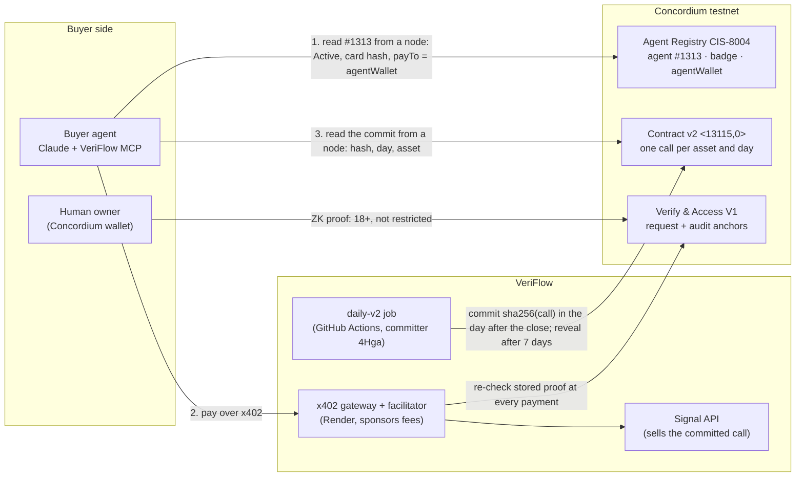
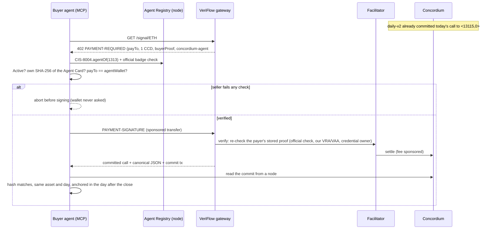

# VeriFlow

**A paid AI agent you can hold to account on Concordium.** Before a buyer agent pays VeriFlow, it reads the Agent Registry to see who it is paying. Before VeriFlow lets anyone buy, the buyer proves eligibility with a zero-knowledge proof, and that proof is re-checked at every payment. Every call VeriFlow sells is committed on-chain before its outcome, one per asset and day, so it cannot be edited, backdated or hedged afterwards.

What is sold is a deliberately simple public rule: a BTC or ETH `RISK_ON` / `RISK_OFF` call from Binance's 30-day momentum, 1 testnet CCD over x402. The call is the reference seller. The product is the three checks around it, which a seller with a private model can reuse.

**Start here:** [TRY_IT.md](TRY_IT.md). Path A takes 2 minutes and needs no wallet: check a call that was really bought, against the chain and Binance. Path B takes about 30 minutes: buy one yourself on testnet.

## How Identity, the Agent Registry and payments work together

| Question | Concordium piece | What happens | See it on-chain | What it does not prove |
|---|---|---|---|---|
| **Who is paid?** | Agent Registry (CIS-8004 [`<12802,0>`](https://ccdexplorer.io/testnet/contract/12802/0)), agent **#1313**, Verified by Concordium badge | Before signing, the buyer reads #1313 **straight from a Concordium node**: Active, the Agent Card hash, the owner, and the payout wallet. It pays only if x402 `payTo` equals that wallet. The 402 names the agent in a `concordium-agent` extension, as a pointer only; the wallet always comes from the chain. Any failure means the wallet is never asked to sign. | Wallet bound by [`setAgentWallet` `8238b866…`](https://ccdexplorer.io/testnet/transaction/8238b866de05398d95fd66be64a74b1f0e86279cd2b748838ebaa5fd4e44e33b) to [`3WSAJwTZ…`](https://ccdexplorer.io/testnet/account/3WSAJwTZqVRypnGMkUjW28QDES8h1FUBoCwrzQ1rdN35NGavf8) | A stock x402 client pays `payTo` without asking. The badge's identity check itself is Concordium's hosted service, not on-chain data. |
| **Who may buy?** | Verify & Access V1 | The buyer proves age ≥ 18 and residence outside CU, IR, KP, SY and US, without revealing either. The request (VRA) and audit record (VAA) are anchored. **At every payment** the gateway re-runs the official check on the stored proof. It also requires both anchors to be VeriFlow's own and the credential to still belong to the paying account. Any failure, including a node error, refuses the payment. | Buyer `4Vf4…`: [VRA `edc30fac…`](https://ccdexplorer.io/testnet/transaction/edc30fac188ba167b37e8f7338ce691a0f00932303201230576056e8a103a5d6), [VAA `c40957b4…`](https://ccdexplorer.io/testnet/transaction/c40957b4731064f10103ae7272509cd26a1863ae75746e74f53d8578b4a71e90) | Whether the restricted list is the right one for a given jurisdiction is a legal question. These are testnet identity providers. |
| **What was sold, and when?** | Smart contract v2 [`<13115,0>`](https://ccdexplorer.io/testnet/contract/13115/0) (Rust, this repo) | The contract accepts **one call per asset and day**, and only within the day after that close. Only a committer appointed by the cold owner [`4dNM…`](https://ccdexplorer.io/testnet/account/4dNMXmNKa2i5hvABfbRJ6NebGopaWSPNmMrbvroSzgJF5wjUNt) can commit, and the owner itself cannot. After 7 days anyone can reveal. The contract hashes the text and checks its asset, day, and `RISK_ON ⇔ momentum_e6 > 0`. | Committer [`4HgaCRwX…`](https://ccdexplorer.io/testnet/account/4HgaCRwXHYWLAbHA4NE5LD8Cv8xYvuW4hP6RACaT1xVwT3nmCj) appointed by [`6e3eb548…`](https://ccdexplorer.io/testnet/transaction/6e3eb5483acbcdbf87717649b0941812513220c52b0623cc652c80678dc7668f) | That a call is right. The rule is public and carries no edge. The record shows calls were made before outcomes and never changed. |

**The latest purchase, end to end (2026-11-22).**

1. A buyer agent checked the seller 5/5.
2. It paid 1 CCD: [`5c939e2c…`](https://ccdexplorer.io/testnet/transaction/5c939e2cd467525e59ffabccf8a30d3621ec32139ddb8fe5239672b56f2e7dc3). The payment settled only after the buyer's stored proof passed the re-check.
3. It received `{"as_of":"2026-11-21","asset":"ETH","momentum_e6":-294462,…,"signal":"RISK_OFF"}`.
4. It verified the call 5/5 from a node, with no VeriFlow server involved:
   - the commit [`4f2a0474…`](https://ccdexplorer.io/testnet/transaction/4f2a04747f40df0dbd1f480498c46f5426685cfacf1a7dd6400ed92fe1677114) is finalized;
   - it carries this commitment;
   - the text hashes to it;
   - it was anchored after the close and within a day of it;
   - it sits under ETH, 2026-11-21 on `<13115,0>`.

## Which scoring rule covers which call

| Contract | Rule | Fixed on-chain before | What it publishes |
|---|---|---|---|
| **v2 `<13115,0>`** (live since 2026-11-22) | [`docs/SCORING-v2.md`](docs/SCORING-v2.md) + [`gateway/src/score-v2.ts`](gateway/src/score-v2.ts) at `8d07d44`, registered in [`ecadec1b…`](https://ccdexplorer.io/testnet/transaction/ecadec1b75cd764a2f87c512787cb3e5422148852760046978e2e4324d8b3271) | the first commit (rule 07:06 UTC, committer 07:33, first commit 08:03 on 2026-11-22) | Integrity counts every day. A performance number appears only if no day ever fails, starting when the first exit candle closes on **2026-11-30 00:00 UTC**. It is the mean 7-day return against both constant books, and never a hit rate. |
| v1 `<13094,0>` (retired 2026-11-22) | [`docs/SCORING.md`](docs/SCORING.md) + [`gateway/src/score.ts`](gateway/src/score.ts) at `94c7603`, registered in [`39356396…`](https://ccdexplorer.io/testnet/transaction/39356396cd2f61573caae2228a68c770aa086b14195385b64b86e477cc3e8d95) | any price outcome | Integrity only. Block day 2026-11-20 holds 3 BTC and 2 ETH commits, which v1 could not reject. That day is why v2 exists. Days after v1 retired are counted as missing, by the rule fixed beforehand. |

The `score-v2` (four times a day) and `score` (twice a day) workflows rerun these rules on GitHub's machines from the chain and Binance. To check a registration yourself, hash the files at the named commit and compare them with the transaction's data. The exact commands are in [TRY_IT.md](TRY_IT.md) Path A, step 4.

**Daily operation, on GitHub's machines and not on VeriFlow's server:**

| Workflow | Job | Schedule |
|---|---|---|
| [`daily-v2`](https://github.com/jiahaoc040-ai/veriflow/actions/workflows/daily-v2.yml) | Commits the calls and reveals due ones | scheduled hourly (GitHub delays scheduled runs; commits so far landed 00:04–08:03 UTC) |
| [`score-v2`](https://github.com/jiahaoc040-ai/veriflow/actions/workflows/score-v2.yml) | Scores the calls | scheduled four times a day (GitHub may delay or skip scheduled runs) |
| [`watch`](https://github.com/jiahaoc040-ai/veriflow/actions/workflows/watch.yml) | Checks that agent #1313's wallet, card, status and owner, and contract v2's owner and committer, have not changed | every 6 hours |

**Live service:** https://veriflow-yrhp.onrender.com (testnet)
- `GET /signal/BTC` answers **402** with the price, `payTo`, the buyer-proof requirement and the `concordium-agent` extension.
- [`/verify`](https://veriflow-yrhp.onrender.com/verify): buyer eligibility.
- [Agent Card](https://veriflow-yrhp.onrender.com/.well-known/agent-card.json).
- Hosted read-only MCP at `/mcp` and A2A at `/a2a`. Paying runs in the local MCP server with the buyer's own key.

**Docs:** [Try it](TRY_IT.md) · [Scoring rule v2](docs/SCORING-v2.md) · [Path to production](docs/GO_LIVE.md) · [Threat model](docs/THREAT_MODEL.md)

[](https://github.com/jiahaoc040-ai/veriflow/actions/workflows/test.yml)
[](https://github.com/jiahaoc040-ai/veriflow/actions/workflows/docker.yml)
[](https://github.com/jiahaoc040-ai/veriflow/actions/workflows/contract.yml)
[](https://github.com/jiahaoc040-ai/veriflow/actions/workflows/security.yml)
[](https://github.com/jiahaoc040-ai/veriflow/actions/workflows/codeql.yml)

These badges show the code builds and its tests and scans pass: gateway, Python, the contract's Wasm end-to-end tests, Docker, and security. They are not evidence for the on-chain claims above. The links in the tables are.

Built for the [Concordium Trusted Agents Hackathon](https://www.concordium.com/article/concordium-trusted-agents-hackathon-encode-club) (Encode Club, 2026). Every transaction linked here is a Concordium testnet transaction.

## Architecture





## History and components

The first end-to-end run, on v1 (2026-11-20): buyer proved eligibility with Verify & Access V1 ([VRA](https://ccdexplorer.io/testnet/transaction/319fb153a51071110ac719949fba70db3dae5ad853e13d061b50cd3ae4a32df3) · [VAA](https://ccdexplorer.io/testnet/transaction/6e98cdabd513ade5ba5b69b662d0b6ab43a147e7f1ebd797b0e8b5db82024ca9)), paid 1 CCD over x402 ([payment](https://ccdexplorer.io/testnet/transaction/30617d582f4d927dd28c55aba0741446a543de8f116e8633cc356bb209c6d2c7)), and the signal was committed through the registry contract ([commit](https://ccdexplorer.io/testnet/transaction/98a8c8b9ca7c021fa39021b090196db748097547146cce453bc7f30b0bb1a61c)); the public dashboard verifies it in the browser.

| Component | State |
|---|---|
| Signal engine (`veriflow/signal.py`) | ✅ works, tested |
| Signal API (`veriflow/api.py`) | ✅ works, tested; returns 402 without the gateway secret, and fails closed when no secret is configured |
| Ledger (`veriflow/ledger.py`) | ✅ counts committed, matured and duplicate calls per contract; no hit rate (scoring is `score-v2.ts`) |
| On-chain anchoring (`gateway/src/anchor.ts`) | v1 history: paid signals were first anchored as register data, then through contract `<13094,0>`. v2 calls are committed by `daily-v2` to `<13115,0>`. |
| x402 gateway + self-hosted facilitator (`gateway/`) | ✅ end-to-end testnet payment settled ([tx](https://ccdexplorer.io/testnet/transaction/db37928ff59f3f9ecbaaaf675ba1c8e566677fcec06b76b5af8243169a8848d5)) |
| Verify & Access V1 buyer eligibility (`gateway/src/eligibility.ts`, `/verify`) | ✅ ZK proof of age ≥ 18 + country not restricted, request and audit anchored on-chain ([VRA](https://ccdexplorer.io/testnet/transaction/61e5269537735f09a8234703a0c7c65bf9039b9bc071296b47781b4ec97b4c24), [VAA](https://ccdexplorer.io/testnet/transaction/c4dab99b0d273c3c2ee04a531238a4f5dcc4a0aef0f08db606316d6af72e3e5c)); unverified accounts are refused before payment settles; verified buyer then paid ([payment](https://ccdexplorer.io/testnet/transaction/04a9c9383eb689598ef9068aeaaf97160daf9af50e31e6274483b0792939f8fd), [anchor](https://ccdexplorer.io/testnet/transaction/973eaa16558c5f5f8aeb2c4d6e5804ef8db0271a06de62193432ad613ba68aca)) |
| Rust smart contract (`contract/`) | ✅ on-chain commit–reveal registry deployed on testnet at `<13094,0>` ([init tx](https://ccdexplorer.io/testnet/transaction/590bb53e65c96599613b547370be32ecad8fef7aaf6dac405021eb35c6e01b88), module `7685e945…`); the gateway commits paid signals through it ([commit tx](https://ccdexplorer.io/testnet/transaction/d538e13d0624acbedc1f7b97a77da43cc82ded28522febcdab2b8f522741e0ab)); CI builds the Wasm and runs 8 end-to-end tests |
| A2A endpoint (`gateway/src/a2a.ts`) | ✅ `POST /a2a` JSON-RPC `message/send`, read-only skills (track record, commitments, verify, eligibility, how to buy); the Agent Card `url` points here |
| Agent Registry + Verified by Concordium badge (`gateway/src/registry.ts`, [`agent-card.json`](agent-card.json)) | ✅ registered as CIS-8004 agent #1313 on testnet `<12802,0>` ([tx](https://ccdexplorer.io/testnet/transaction/fe34bd0b8299a07855dd664648c78caf08fcb33433f92a635d9b1bde189462eb)), badge `JyP9UWYKh54TD2MUJDfqC`, card hash pinned ([tx](https://ccdexplorer.io/testnet/transaction/e33d24fbf3869ca57453c43cb5b94e05da4172579e47004c95585a99c53342b3)); official `check_badge`: all 15 checks pass |
| Daily public signals (`gateway/src/daily-v2.ts`, `daily-v2` workflow) | ✅ since 2026-11-22 a GitHub Actions job commits one BTC and one ETH call per daily close to contract v2 [`<13115,0>`](https://ccdexplorer.io/testnet/contract/13115/0) from the committer `4Hga…`, a separate account from the owner that the owner can revoke. The contract rejects a second call for the same asset and day and any commit outside the day after the close. v1 (`<13094,0>`, committed by the server) retired on 2026-11-22. |
| MCP server (`gateway/src/mcp.ts`, hosted: `/mcp`) | ✅ hosted read-only endpoint at [`/mcp`](https://veriflow-yrhp.onrender.com/mcp) (Streamable HTTP) + 6 tools over stdio: `get_signal` (pays via x402), `get_track_record`, `list_commitments`, `verify_signal` (reads Concordium directly), `check_eligibility`; one-command Claude Desktop install (`npm run mcp:config -- --install`); `check_seller` verifies the seller before paying |
| Dashboard + one-click on-chain verification (`dashboard.py`) | ✅ |

**Claude Desktop as the buyer agent (2026-11-20):** over the VeriFlow MCP server, Claude verified the seller in the Agent Registry (5/5: badge, Active, own card hash, `payTo` = on-chain `agentWallet`), paid 1 testnet CCD ([payment](https://ccdexplorer.io/testnet/transaction/d15729125ad24beb7767a3378fc4b6e1f830608098c8978eb1c0a9a537b8e792)), and verified the ETH signal straight from a Concordium node (4/4, including "anchored within a day of the data close"; [anchor](https://ccdexplorer.io/testnet/transaction/c2def7e65cb5346b2a66f8f469e15ac1bb9c32685471fa085bc2c381b1334083)). No human step besides approving the tool calls.

## Contract v2 (live since 2026-11-22)

| What | Transaction |
|---|---|
| Contract `<13115,0>` created by the cold owner `4dNM…` from the reviewed module `08e3b49e…` | [`dba400c2…`](https://ccdexplorer.io/testnet/transaction/dba400c20a96eaa1609e5e1f954ac5887aa473785ad5676b3dad99364263a946) (06:29 UTC) |
| Scoring rule v2 registered (hashes of `docs/SCORING-v2.md` and `gateway/src/score-v2.ts`) | [`ecadec1b…`](https://ccdexplorer.io/testnet/transaction/ecadec1b75cd764a2f87c512787cb3e5422148852760046978e2e4324d8b3271) (07:06 UTC) |
| Committer `4Hga…` appointed, after the rule | [`6e3eb548…`](https://ccdexplorer.io/testnet/transaction/6e3eb5483acbcdbf87717649b0941812513220c52b0623cc652c80678dc7668f) (07:33 UTC) |
| First calls, `as_of` 2026-11-21: BTC, ETH | [`fe340eea…`](https://ccdexplorer.io/testnet/transaction/fe340eeaa2623405880a57208c88004fb4f12b7b56479876e8be6f24a4ada718), [`4f2a0474…`](https://ccdexplorer.io/testnet/transaction/4f2a04747f40df0dbd1f480498c46f5426685cfacf1a7dd6400ed92fe1677114) (08:03 UTC) |
| A buyer agent paid 1 CCD for the BTC call and verified it 5/5 from a node (confirmed, commitment, content hash, anchored within a day, committed under its own asset and day) | [payment `935bc182…`](https://ccdexplorer.io/testnet/transaction/935bc182245754dfef95661c7006beed4fd8635e8c40605c96a2ad571f7c1879) |

The purchased call was `{"as_of":"2026-11-21","asset":"BTC","momentum_e6":-260395,…,"signal":"RISK_OFF"}`. Binance closes give 60215.77 / 81416.09 − 1 = −0.2603947…, which is `momentum_e6` −260395. The first v2 call resolves when its exit candle closes on 2026-11-30 00:00 UTC. Until then the rule publishes no performance number.

## The signal

The signal is a **risk regime** (`RISK_ON` / `RISK_OFF`) for BTC and ETH. In v2 it is one public rule that anyone can recompute:

- `momentum_e6` is the 30-day change in the Binance spot daily close, in millionths. It is computed in exact integers from Binance's decimal strings and rounded half away from zero.
- `RISK_ON` exactly when `momentum_e6 > 0`. The contract itself rejects a reveal whose label contradicts its `momentum_e6`.

v1 also used a stablecoin-supply z-score from DefiLlama, with OKX as a price fallback. v2 drops both. DefiLlama rebuilds its history in place, so nobody could recompute that input later. A fallback chosen after the fact could move the result.

**What the record proves.** Each call was committed before its outcome, under its own asset and day, and was not edited afterwards. It does not prove that the calls are right. The rule is public and carries no edge. The scoring rule publishes performance only against both constants (always on, always off), only once days mature, and never as a hit rate.

*Not investment advice.*

## Commit–reveal

Each signal is serialized to canonical JSON (sorted keys) including a random `nonce`, then hashed with SHA-256. The hash is anchored on Concordium when the signal is issued. Because a signal has only two values, the nonce stops anyone from guessing the signal from its hash before paying. After the 7-day horizon, the full JSON is public and anyone can recompute the hash and check it against the chain.

## Run it

```bash
pip install -r requirements.txt
python -m pytest -q          # offline tests
python scripts/run_signal.py BTC
VERIFLOW_INSECURE_DEV=1 uvicorn veriflow.api:app --reload    # local only: without GATEWAY_SECRET the API refuses /signal unless this flag is set
```

No API keys are needed. The v2 call (`gateway/src/signal-v2.ts`, produced by `npm run daily2`) uses only Binance daily closes. The Python engine above is the retired v1 signal, which also used DefiLlama stablecoin supply; it is kept for history and tests.

## Verify it yourself

`streamlit run dashboard.py` shows every commitment with a **one-click verify** button (it reads through the gateway's `/onchain`; the check that a v2 call sits under its own asset and day is only in the TypeScript verifier used by `verify_signal`). It reads the transaction back from Concordium, decodes `veriflow:v1:<hash>`, and checks it against the commitment. A buyer can paste the `canonical` signal they received; change a single character and verification fails. With the content in hand it also checks the anchoring block's time: a signal must be on-chain within a day of its data close, so a record written after the outcome was known fails verification. The same checks run in the public dashboard (in the browser), `veriflow/verify.py`, and the MCP `verify_signal` tool.

## Trust in both directions

| Who checks | What | How |
|---|---|---|
| **Seller → buyer** | The paying account's owner is 18+ and not resident in a restricted country | Verify & Access V1 zero-knowledge proof, request and audit anchored on-chain by VeriFlow. The stored proof is re-checked in the gateway's `onBeforeVerify` hook before **every** payment settles. |
| **Buyer → seller** | The agent being paid is identity-verified, Active, its Agent Card is unchanged, and the money goes to **its own on-chain wallet** | Agent #1313 is read straight from a Concordium node (`CIS-8004.agentOf` on `<12802,0>`, `gateway/src/registry-node.ts`). The hosted registry service is used only to resolve the badge and for the official badge check, and its answer must agree with the node. The buyer recomputes the card's SHA-256. x402 `payTo` must equal the on-chain `agentWallet`. The 402's `concordium-agent` extension must name the same agent. |

The buyer check runs in an x402 client hook (`onBeforePaymentCreation`, `gateway/src/counterparty.ts`), so a seller that fails it is never even signed for — the wallet is not asked. It fails closed: if the registry is unreachable, the agent does not pay. This stops the impersonation attack where a scam endpoint copies an honest agent's badge and Agent Card but asks to be paid at its own address.

VeriFlow binds its x402 `payTo` to agent #1313 on-chain with `npm run registry -- set-wallet 1313`: the payout account signs the official 162-byte `setAgentWallet` authorization (the command checks every byte — token, owner, wallet, deadline, contract, chain — before signing) and the owner submits it. Done on testnet ([setAgentWallet tx](https://ccdexplorer.io/testnet/transaction/8238b866de05398d95fd66be64a74b1f0e86279cd2b748838ebaa5fd4e44e33b)): agent #1313's `agentWallet` is the x402 payout account `3WSAJwTZ…`. Any buyer agent, not just ours, can then check that paying VeriFlow pays VeriFlow.

## Operations

`/health` reports the API status and the operator account. Since 2026-11-22 that is the committer `4Hga…`, which pays for v1 reveals, eligibility anchors and sponsored buyer fees. The cold owner `4dNM…` is not on the server. The response is `{"ok":true,"operator":{"account":…,"balance_ccd":…,"low":false}}`. The balance is refreshed every 10 minutes in the background, and `low` turns true below `MIN_OPERATOR_CCD` (default 100). The on-chain state that only the cold owner can change is watched by the `watch` workflow.

## Agent guardrails

The demo buyer agent only pays in testnet CCD and refuses any single payment above `MAX_PAY_MICROCCD` (default 2 CCD), using x402 client spend controls. A seller that raises its price or switches asset cannot drain the buyer. Before signing, it verifies the seller as above (`REQUIRE_SELLER_BADGE=true`).

## x402 payment gateway (`gateway/`)

No public Concordium x402 facilitator was available, so VeriFlow runs its own with the official `@x402/concordium` package. The facilitator sponsors the transaction fee, so a buyer agent only needs the signal price in CCD.

```
buyer agent ──GET /signal/BTC──▶ gateway :4020 ──402 + requirements──▶ buyer
buyer signs a sponsored CCD transfer ──▶ gateway ──verify/settle──▶ facilitator :4021 ──▶ Concordium testnet
paid ──▶ gateway ──X-VeriFlow-Gateway secret──▶ Python API :8000 ──▶ signal
```

```bash
cd gateway && npm install
cp .env.example .env                 # fill in key files, SELLER_ADDRESS, GATEWAY_SECRET
npm run facilitator                  # terminal 1
npm run gateway                      # terminal 2 (Python API running on :8000 with the same GATEWAY_SECRET)
npm run buyer -- BTC                 # terminal 3: pays 1 CCD and prints the signal + explorer link
```

## Buyer eligibility (Verify & Access V1)

Before an agent can buy, the person behind its paying account proves once, in the Concordium Wallet, that they are **18+** and **not resident in a restricted country** (`RESTRICTED_COUNTRIES`, default `US,KP,IR,CU,SY`). VeriFlow never sees the birthday or country, only a zero-knowledge proof that the conditions hold.

VeriFlow uses Concordium's official **Verify & Access V1** protocol, so every verification leaves two public, privacy-preserving records on-chain:

```
/verify page ──POST /eligibility/challenge──▶ gateway
   gateway builds the request (age ≥ 18, country ∉ list, one-time nonce, bound to the buyer account)
   and anchors its hash on Concordium ──▶ VRA (Verification Request Anchor), waits for finality
wallet ──requestVerifiablePresentationV1(request)──▶ ZK proof against the anchored request
page ──POST /eligibility/verify──▶ gateway
   cheap checks first: one account credential · statements at least as strict · on-chain IdP · credential belongs to the buyer account
   official SDK check (VerificationAuditRecordV1.createChecked): context matches, proof valid, credential active, request anchored
   pass ──▶ audit record hash anchored ──▶ VAA (Verification Audit Anchor) ──▶ account allowlisted for 30 days
```

At payment time an x402 `onBeforeVerify` hook reads the payer from the signed transaction (`signedTransaction.header.sender`) and re-checks that account's stored proof. The official check is re-run, both anchors must be VeriFlow's, the proof must meet the current policy, and the credential must still belong to the payer. An account that fails gets `buyer_proof_required` and a link to `/verify`. Its transfer is never broadcast, so it is not charged. The 402 response also advertises the requirement up front in `extra.buyerProof`, following the format proposed in x402 issue #4182.

```bash
cd gateway && npm test      # tests: eligibility rules (replay, wrong account, weaker statement, …), seller check, MCP over stdio, contract encoding, verifiers
```

## MCP server — let any agent buy and verify

| Tool | What it does |
|---|---|
| `get_signal` | Pays ~1 CCD over x402 from `BUYER_KEY_FILE` (refuses more than `MAX_PAY_MICROCCD`) and returns the signal, its commitment and the anchor transaction |
| `get_track_record` | Counts of committed and matured calls, and duplicate asset-days (free). No hit rate. |
| `list_commitments` | Every commitment with its Concordium transaction (free) |
| `verify_signal` | Finds the commit transaction through VeriFlow's `/commitments` list, then reads it **from a Concordium node** (our server can hide a commitment, not fake one) and checks: confirmed, carries this commitment, and (with the `canonical` string) the content hashes to it, it was anchored after its data close and within a day of it, and on v2 it sits under its own asset and day |
| `check_eligibility` | Has this account passed the ZK eligibility check? Returns the `/verify` link if not |
| `check_seller` | Without paying, asks the x402 endpoint whom to pay and verifies that seller in the Agent Registry (badge, Active, own card hash, `payTo` = on-chain `agentWallet`). `get_signal` runs the same check and refuses to pay on any failure |

The server also sends MCP `instructions` (check eligibility → judge the track record → verify the seller → buy → verify the signal) and tool annotations (`get_signal` is the only non-read-only tool), so a client knows which call spends money.

**Hosted, nothing to install:** `https://veriflow-yrhp.onrender.com/mcp` (MCP Streamable HTTP, stateless). Add it to any MCP client that supports remote servers — for example as a custom connector in Claude — to get the read-only tools (`get_track_record`, `list_commitments`, `verify_signal`, `check_eligibility`) plus `how_to_buy`, which returns the live x402 terms (network, amount, `payTo`, required buyer proof) without paying. Paying needs the buyer's own wallet, so it happens in the buyer's agent (the local server below, or any x402 client); the hosted server holds nobody's keys. For a check that does not rely on VeriFlow's server: hash the canonical signal you bought (`sha256sum`) and compare it with the `commit` transaction on [CCDExplorer](https://ccdexplorer.io/testnet). The dashboard is a convenience: it recomputes hashes in your browser but reads the chain through VeriFlow's `/onchain` endpoint.

**Claude Desktop, one command** (fills in absolute paths, keeps your other MCP servers, backs up the old config):

```bash
cd gateway && npm run mcp:config -- --install   # buys from the public deployment
# then quit Claude Desktop completely and reopen it: "+" → Connectors → veriflow
```

It checks the buyer key and whether that account has passed eligibility, then writes:

```json
{
  "mcpServers": {
    "veriflow": {
      "command": "/absolute/path/to/node",
      "args": ["--import", "file:///…/gateway/node_modules/tsx/dist/loader.mjs", "/…/gateway/src/mcp.ts"],
      "env": { "GATEWAY_URL": "https://veriflow-yrhp.onrender.com" }
    }
  }
}
```

Absolute paths because Claude Desktop starts servers with a short `PATH` and outside the project folder (`npx`/`tsx` there fail with `ENOENT` or `env: node: No such file or directory`). No secrets go into the config — the server reads `gateway/.env` and `keys/` itself. Use `--local` to point it at a gateway on `localhost:4020`. Logs: `~/Library/Logs/Claude/mcp-server-veriflow.log` (macOS). `test/mcp.test.ts` launches the server exactly this way — from `/`, with a minimal environment — and talks to it over stdio.

## A2A — agent-to-agent

The Agent Card's `url` points to a real A2A JSON-RPC endpoint: `POST https://veriflow-yrhp.onrender.com/a2a` with `message/send` (A2A 0.3.0, stateless). Another agent sends a message — free text like "what is your track record?" / "verify <commitment>" / "is <account> eligible?" / "how do I buy?", or a data part `{"skill": "track_record" | "commitments" | "verify_signal" | "eligibility" | "how_to_buy"}` — and gets back an agent message with a short text answer and the full result as a data part. Like the hosted MCP endpoint it is read-only: paying happens from the buyer's own wallet over x402. The card also lists the hosted MCP endpoint under `services`. The updated card was re-pinned on-chain ([setAgentURI tx](https://ccdexplorer.io/testnet/transaction/39cdf81f4a8dd2f75aeb5c03832368586cd45a9031196ea5f53ab1f7ffee4e09)); the official badge check still passes 15/15.

```bash
curl -s https://veriflow-yrhp.onrender.com/a2a -H 'Content-Type: application/json' -d '{"jsonrpc":"2.0","id":1,"method":"message/send","params":{"message":{"role":"user","messageId":"1","parts":[{"kind":"text","text":"how do I buy a signal?"}]}}}'
```

## Smart contract v2 — one call per asset and day (`contract-v2/`, Rust)

Deployed on testnet as [`<13115,0>`](https://ccdexplorer.io/testnet/contract/13115/0) from module `08e3b49e…`, which CI built from `5e699ad` ([init `dba400c2…`](https://ccdexplorer.io/testnet/transaction/dba400c20a96eaa1609e5e1f954ac5887aa473785ad5676b3dad99364263a946)). There is no upgrade, delete or replace entrypoint.

| Entrypoint | Who | Rule enforced on-chain |
|---|---|---|
| `commit(asset, as_of, hash)` | the appointed committer only, never the owner or one of its aliases | `asset` is `BTC` or `ETH`. `as_of` is a real `YYYY-MM-DD` date. The block time must be in `[as_of+1d, as_of+2d)` UTC. A second commit for the same `(asset, as_of)`, or a reused hash, is rejected. |
| `reveal(canonical)` | **anyone**, 7 days after the commit | The contract computes SHA-256, finds the slot, and parses the fixed schema. It requires `asset` and `as_of` to equal the key, and `signal` to be `RISK_ON` exactly when `momentum_e6 > 0`. |
| `set_committer`, `revoke_committer` | the cold owner | Appoints one committer (it replaces the previous one) or removes it. |
| `slot`, `view` | anyone | Read one `(asset, as_of)` slot, or the totals, owner, committer and init time. |

```bash
cd contract-v2 && cargo test --lib          # unit tests; the end-to-end tests run in CI against the compiled Wasm
cd gateway && npm run contract2 -- status   # owner, committer, issued, revealed
```

v1 (`contract/`, `<13094,0>`) keyed commits by hash only, so a second hash for the same day was just another commit. It is retired, and its reveals continue.

## Verified by Concordium

VeriFlow is CIS-8004 agent **#1313** in Concordium's testnet Agent Registry `<12802,0>`. Badge: **`JyP9UWYKh54TD2MUJDfqC`** (`ccd:4221332d34e1694168c2a0c0b3fd0f27/cis-2:JyP9UWYKh54TD2MUJDfqC`).

Anyone can check it without trusting us: read the agent with CIS-8004 `agentOf` (`npx tsx src/registry-node.ts 1313` in `gateway/`), confirm the owner account and `Active` status, then fetch [`agent-card.json`](agent-card.json) and compare its SHA-256 with the on-chain `metadata_hash`. Concordium's hosted checker does all of this: `GET https://agent-registry-mcp.concordium.com/v1/badge-check/JyP9UWYKh54TD2MUJDfqC`.

> ⚠️ `agent-card.json` is hash-pinned on-chain. Editing it breaks the badge until the new hash is pinned with `npm run registry -- set-uri 1313`. `npm test` fails if the file changes, as a reminder.

## Deploy (one container)

The `Dockerfile` runs the Python API, the facilitator and the gateway together; the public port serves the dashboard (`/`), buyer verification (`/verify`), the paid `/signal/{asset}` and the Agent Card (`/.well-known/agent-card.json`). CI builds the image and smoke-tests it against Postgres on every change.

Target: **Render free web service + Neon Postgres**, both free without a card. `render.yaml` is a one-click Blueprint. Render's free plan has 512 MB, so the facilitator runs inside the gateway process; CI runs the container capped at 512 MB. The `keepalive` workflow requests `/health` every 10 minutes so the free instance rarely sleeps; GitHub can delay scheduled runs, so a judge may still occasionally wait for a cold start (about a minute). (Hugging Face Docker Spaces now need a paid plan; the wrapper in `deploy/huggingface/` still works there.)

| Secret / variable | Value |
|---|---|
| `FACILITATOR_KEY_JSON` | contents of the **testnet** sponsor/anchor account `.export` file |
| `SELLER_ADDRESS` | account that receives payments |
| `GATEWAY_SECRET` | any long random string |
| `DATABASE_URL` | Postgres connection string (signals and buyer approvals survive restarts) |
| `PUBLIC_URL` | the deployment's public URL |
| `REGISTRY_CONTRACT` | optional: commit through the Rust contract |

**Hardening for a public URL.** Every `/eligibility/challenge` call anchors a transaction and spends CCD, so it is rate-limited per IP, per account and by a site-wide hourly budget (`CHALLENGES_PER_HOUR`, default 60) that rotating IPs cannot bypass. Pages are served with a strict CSP (inline scripts and styles allowed only by SHA-256 hash, no `unsafe-inline`), CORP/COEP, `no-store`, `nosniff`, `no-referrer` and HSTS. The one deliberate exception: `/verify` allows `unsafe-eval`/`wasm-unsafe-eval`, because the Concordium Browser Wallet injects its SDK into the page's main world and needs them; script sources there are still limited to our own hashed scripts. A passive ZAP baseline of the live site runs weekly and reports no high-risk findings. CI runs Trivy (vulnerable dependencies and committed secrets) on every push; a ZAP baseline scan of the deployed URL can be run from the Actions tab.

The buyer agent's key never goes to the server: agents pay from their own machine (demo buyer or MCP server).

## API

| Method | Path | Access |
|---|---|---|
| GET | `/signal/{asset}` | paid (x402 gateway) |
| GET | `/track-record` | public |
| GET | `/commitments` | public |
| GET | `/commitments/{c}` | public; reveals the full signal after the 7-day horizon |
| GET | `/verify` | public; wallet page for the ZK eligibility proof |
| POST | `/eligibility/challenge`, `/eligibility/verify` | public |
| GET | `/eligibility/{account}` | public; is this account allowed to buy? |
| GET | `/health` | public |
